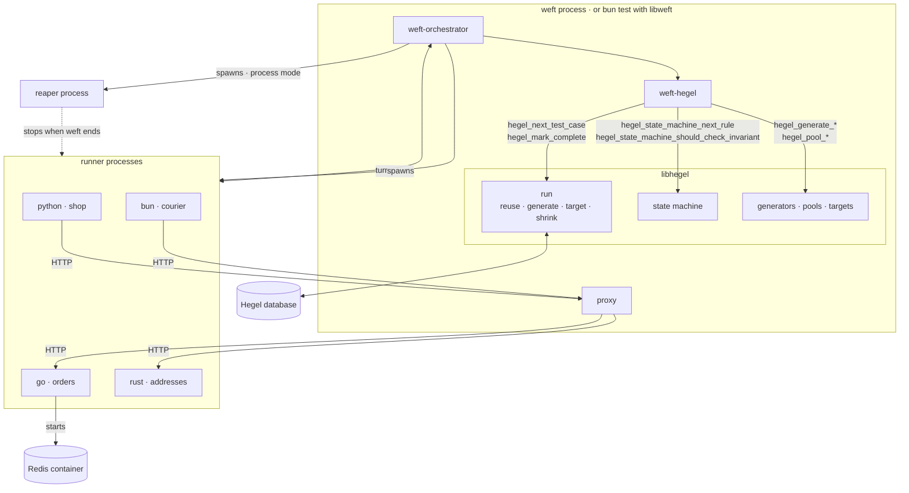

# weft

A distributed runner for [Hegel](https://hegel.dev) property tests

## Install

```sh
bun add -d git+ssh://git@github.com/ahmedtwine/weft.git#v0.7.0
```

## Run the examples

```sh
mise trust && mise install
mise //examples:test      # build weft and run the examples
```


## Example Tests

`examples/tests/bank.go.weft.kdl`:

```kdl
setup {
  person "owner"
  api "bank" {
    state {
      balance "int"
    }
    action "deposit" {
      input "amount" "1..100"
      writes "bank.balance"
    }
    action "withdraw" {
      input "amount" "1..100"
      writes "bank.balance"
    }
    invariant {
      igte "bank.balance" 0
    }
  }
}
impl "go" {
  module "bank" "../services/go/bank/bank.go" {
    reset "bank.Reset"
    state "bank.State"
    action "deposit" "bank.Deposit"
    action "withdraw" "bank.Withdraw"
  }
}
```

`examples/services/go/bank/bank.go` is the app, plain Go code:

```go
func Reset() { bank = Bank{} }

func State() Bank { return bank }

func Deposit(given Amount) { bank.Balance += given.Amount }

func Withdraw(given Amount) {
	if given.Amount <= bank.Balance {
		bank.Balance -= given.Amount
	}
}
```


```text
✕ tests/bank.go.weft.kdl · bank.balance = -1 < 0
  0 · start · - · bank: balance = 0 · -
  1 · withdraw to=bank · amount=1 · bank: balance = -1 · bank.balance = -1 < 0
```


## Single Test with Multiple Language Runners

`tests/parcel.weft.kdl` runs the 4 example runner:

| App         | Runner     | Does                                                                                   |
| ----------- | ---------- | -------------------------------------------------------------------------------------- |
| `orders`    | Go         | Keeps each order in Redis in a testcontainer                                           |
| `addresses` | Rust       | Keeps the address book                                                                 |
| `shop`      | Python     | Signs up customers, adds addresses, places orders, and changes the address of an order |
| `courier`   | TypeScript | Ships an order to its address                                                          |

Each app reaches another app at `WEFT_<MODULE>_URL`. weft forwards each request and records it as a hop:

```kdl
action "place_order" {
  input "customer" from="customers"
  input "address" from="addresses"
  where {
    eq "address.owner" "customer"
  }
  returns "placed" id="order" customer="customer"
  adds "orders" "placed"
  writes "orders.orders"
}
```




## Dashboard

`weft --ui [<file>…]` serves the dashboard at http://127.0.0.1:7357:

                                                              |

## License

MIT. `mise run notices` writes `THIRD-PARTY-NOTICES.md`, the license of each part weft ships: Hegel and each crate it links, the Lucide icons, Perspective and Pele.
