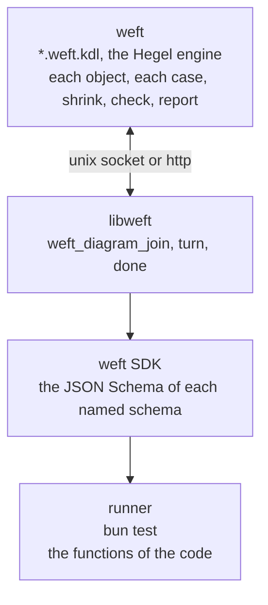

# weft

A distributed runner for property tests, built on [Hegel](https://hegel.dev) and [KDL](https://kdl.dev) files.



weft owns each case and draws each object. A runner sends the JSON Schema of each schema that the `impl` block names. weft draws each input from that schema with the Hegel engine and sends it with the turn. The runner calls the named function with the input and gives the state. A runner has no generator and makes no object.

## Start

Add `weft` from GitHub at a release tag, for example `bun add github:ahmedtwine/weft#v0.2.2`. The `weft` command gets the build of its version for the platform from the GitHub release on its first run, and runs it. Each tag `v<version>` of `package.json` and `Cargo.toml` makes a release with builds for `linux-x64` and `darwin-arm64`. The release is published only after the tests and clippy pass and the `weft` command and `libweft` of the release run on each platform. Otherwise the release and the tag are deleted.

`weft.kdl`

```kdl
include "**/*.weft.kdl"
theme "light"
style "person" icon="user"
style "browser" icon="app-window"
adapter "bun" cases=100
```

`src/page.ts`

```ts
import { z } from "zod";

let count = 0;

export const pageSchema = z.strictObject({
  count: z.number().int().meta({ weft: { read: "page.count" } }),
});
export const sendSchema = z
  .strictObject({ text: z.string() })
  .meta({ weft: { verb: "send" } });
export const reloadSchema = z.strictObject({}).meta({ weft: { verb: "reload" } });
export const page = () => ({ count });
export const clear = () => {
  count = 0;
};
export const send = () => {
  count += 1;
};
export const reload = () => {};
```

`invariants/page.weft.kdl`

```kdl
setup {
  person "user"
  browser "page" count=0 {
    draw {
      text "hello" "good day"
    }
    state count=0 {
      on "send" count=1
    }
    state count=1 {
      on "reload" count=1
    }
  }
}
action {
  send from="user" to="page"
  reload from="user" to="page" page.count=0
}
check {
  invariant {
    forall "browser" "page" {
      implies {
        in "step" "reload"
        eq (next)"browser.count" "browser.count"
      }
    }
  }
}
impl "bun" {
  module "page" "../src/page.ts"
  start "page.clear"
  read "page.page" output="page.pageSchema"
  run "page.send" input="page.sendSchema"
  run "page.reload" input="page.reloadSchema"
}
```

```
$ weft
✓ invariants/page.weft.kdl · Always, for each browser in page, if step is reload, then browser.count stays unchanged
  adapter bun · 100 cases · 100 runs · 1405 steps · 1305 checks [0.27s]
  step · action · input · state · check
  0 · start · - · page: count = 0 · -
  1 · send to=page · text="hello" · page: count = 1 · -
  2 · reload to=page · - · page: count = 1 · -
  …
  action · steps · checks
  send to=page · 100 · 0
  reload to=page · 1305 · 1305
  code · files · lines
  start · 1 · 3
  send · 1 · 3
  reload · 1 · 2
  draw · cases
  text "good day" · 56.0%
  text "hello" · 44.0%

 1 pass
 0 fail
 1305 checks
Ran 1 file in 0.29s
```

`weft <file>…` runs only the named diagrams. `weft --ui` serves the diagrams at http://127.0.0.1:7357.

## File

A file of weft has the KDL that versions 1 and 2 share. A parser of version 1 and a parser of version 2 read it the same, and weft refuses each other form.

| Part | Form | Refused |
| --- | --- | --- |
| The name of a line, a key | A word: `browser`, `page.count`, `aria-label` | `"browser"`, a word with `<`, `>` or `,` |
| A text | A string in `"`: `"page"`, `""`, `"a \"b\""`, with the escapes `\n` `\r` `\t` `\\` `\"` `\b` `\f` `\u{…}` | `page`, `#"page"#`, `"""`, `\s`, `\/` |
| A number | An integer: `0`, `-1` | `0.5`, `1_000`, `0x1f` |
| The time of a term in `check` | `(next)"<kind>.<key>"`, `(start)"<kind>.<key>"` | each other `(…)` |
| The end of a line | The end of its text line | `;` |
| A line with many values | `\` at the end of a text line continues the line | |

```kdl
tagName \
  "div" "span" "p" "a" "li" "i" "button" \
  "input" "textarea" "select" "option" "img" "video"
```

## Impl

`impl "<adapter>"` joins the diagram to the code of one runner. It is the only source of objects.

| Line | Use |
| --- | --- |
| `module "<name>" "<place>"` | Code of the app that the runner loads. A place that starts with `../` is a file from the directory of the diagram. weft refuses a file in the directory of the diagram, and a module that no line names. |
| `start "<module>.<function>" input="<module>.<schema>"` | Starts each case. weft draws one input for each `start` line, and the runner calls the functions in the order of the lines. A `start` line with no `input` calls a function that takes none. `tag="<verb>"` selects the branch of a union that has that verb. |
| `read "<module>.<function>" output="<module>.<schema>"` | Gives the state after the `start` lines and after each step. Each field that the check reads has a `read` annotation. |
| `run "<module>.<function>" input="<module>.<schema>"` | One action. The `verb` annotation of the schema is the verb. A union gives one action for each branch that has a verb. |
| `output="<module>.<schema>"` | On a `run` line. `{ input, result }` of the call is state, with the `read` annotations of that schema. |
| `error="<module>.<schema>"` | On a `start` or `run` line. The message of an `Error` that the function throws is state, with the `read` annotations of that schema. Without it, a throw fails the step. A `TypeError` or another fault of the code always fails the step, and the report shows its file and line. |
| `pool="<pool>"` | On a `start` or `run` line. The result of the call goes to the pool. |
| `run "<pool>" from="<pool>" verb="<verb>"` | One action that calls a value of the pool. `"<pool>.<method>"` calls a method of the value. `consume="<pool>"` in the place of `from` removes the value from the pool. |

Each `verb` and `tag` is the verb of an `on` line. Each `pool` is a pool of an object of `setup`.

weft draws an input again, up to 4 times, when the schema does not parse it. After that, the input is no step. weft fails the run when each input of one line fails its schema.

A part of a schema with no JSON Schema form has no value, and weft draws no branch that needs it.

## Annotation

An annotation is the `weft` key of the metadata of a part of a schema: `.meta({ weft: { verb: "send" } })`. `weft/annotation` gives its type, and `weft/annotation.schema.json` its JSON Schema.

| Key | Use |
| --- | --- |
| `verb` | The branch of an input that is one action of this verb. |
| `read` | The value of `<object>.<key>` in the state. |
| `pool` | Each drawn value of this part goes to this Hegel pool. |
| `from` | This part is a value of this Hegel pool. |
| `consume` | A `from` draw removes the value from the pool. |
| `maxLeaves` | The most leaves of one value of a schema that names itself. |
| `maxDepth` | The most levels of one value of a schema that names itself. |
| `grammar` | A Lark grammar of the texts of this part. |
| `start` | The start rule of the grammar. |

## Draw

The `draw` block of an object of `setup` gives the values of the fields of each input. A `<key> <value>…` line gives the values of one field in each input that has the field. A value applies only to a field of its type. A line with `{ }` has the lines of the keys of its part. The lines of a record with free keys are its keys, and a key has values or none. weft fails the run when a line applies to no field.

```kdl
draw {
  id 1 2 3
  attributes {
    class "is-empty" "a-icon-alt"
    title
  }
}
```

## Pool

A `pool "<name>"` line in an object of `setup` makes one Hegel pool. The key `<name>` of the object is the count of the values of the pool. A `pool` annotation or a `pool=` line adds values, and a `from` annotation or a `from=` line draws one of them.

## Action

weft runs the path of the `action` block in a quarter of the cases, with a drawn input for each step. The other cases run the verbs in a drawn order. A failing case shrinks in the two forms.

## Config

| Line | Use |
| --- | --- |
| `adapter "bun" cases=<count>` | weft starts `bun test` on the `impl "bun"` block of each diagram. |
| `adapter "default" cases=<count>` | weft runs the setup without the code, or waits for runners when the config has a `transport`. |
| `transport "unix" path="<socket>"` | Runners join on a unix socket. |
| `transport "http" url="<url>"` | Runners join over http. |

A runner on another machine runs `bun test` on `weft/harness` with `WEFT_LIB` set to libweft, `WEFT_TRANSPORT` to `unix:<socket>` or to the url and `WEFT_DIAGRAM` to the path of the diagram.

MIT. merman is MIT OR Apache-2.0. Icons are Lucide, ISC, in `crates/weft-draw/src/vendor`.
