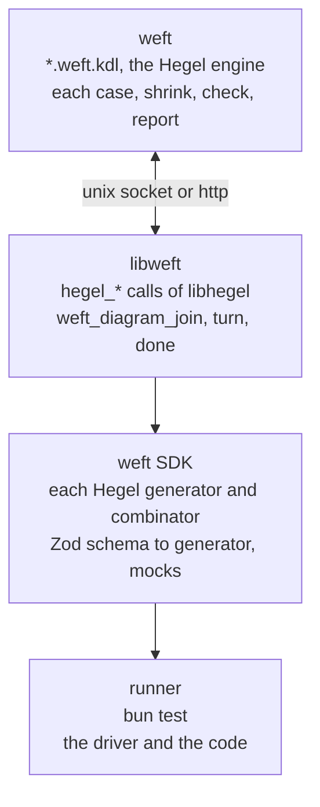

# weft

A distributed runner for property tests, built on [Hegel](https://hegel.dev) and [KDL](https://kdl.dev) files.



weft owns each case. libweft exports the same `hegel_*` calls as libhegel, and the Hegel library of a language loads libweft in place of libhegel. Each draw goes to the engine in weft, so each runner of one diagram draws from the same case, and Hegel shrinks a failing case across all of them.

A runner joins a diagram, takes a turn (`reset`, `run`, `read`), and gives the state. A call with no output goes with the next call that has one.

## Start

Add `weft` from GitHub as a dependency, and build it with `cargo build --release --locked --manifest-path node_modules/weft/Cargo.toml -p weft-cli -p weft-c`. The `weft` command runs that build.

`weft.kdl`

```kdl
include "**/*.weft.kdl"
theme light
style person icon=user
style browser icon=app-window
adapter bun cases=100
```

`src/page.ts`

```ts
import { z } from "zod";

let count = 0;

export const pageSchema = z.strictObject({
  count: z.number().int().meta({ weft: "page.count" }),
});
export const sendSchema = z
  .strictObject({ text: z.string() })
  .meta({ weft: "send" });
export const reloadSchema = z.strictObject({}).meta({ weft: "reload" });
export const page = () => ({ count });
export const clear = () => {
  count = 0;
};
export const send = () => {
  count += 1;
};
export const reload = () => {};
```

`invariants/page.weft.kdl`

```kdl
setup {
  person user
  browser page count=0 {
    state count=0 {
      on send count=1
    }
    state count=1 {
      on reload count=1
    }
  }
}
action {
  send from=user to=page
  reload from=user to=page page.count=0
}
check {
  invariant {
    forall browser page {
      implies {
        in step reload
        eq (next)browser.count browser.count
      }
    }
  }
}
```

`invariants/page.weft.ts`

```ts
import { z } from "zod";
import {
  clear,
  page,
  pageSchema,
  reload,
  reloadSchema,
  send,
  sendSchema,
} from "../src/page";

export const state = z.strictObject({ page: pageSchema });
export const read = () => ({ page: page() });
export const reset = clear;
export const sent = { input: sendSchema, run: send };
export const reloaded = { input: reloadSchema, run: reload };
```

```
$ weft
✓ invariants/page.weft.kdl · Always, for each browser in page, if step is reload, then browser.count stays unchanged
  adapter bun · 100 cases · 100 runs · 1785 steps · 1686 checks [1.22s]
  step · action · input · state · check
  0 · start · - · page: count = 0 · -
  1 · send to=page · text="\u00056-\u0004" · page: count = 1 · -
  2 · reload to=page · - · page: count = 1 · -
  …
  action · steps · checks
  send to=page · 99 · 0
  reload to=page · 1686 · 1686
  code · files · lines
  reset · 2 · 4
  send · 2 · 4
  reload · 2 · 3

 1 pass
 0 fail
 1686 checks
Ran 1 file in 1.23s
```

`weft --ui` serves the diagrams at http://127.0.0.1:7357.

## Driver

The driver joins the diagram to the code. It has no schema and no function of its own.

| Export | Use |
| --- | --- |
| `state` | The schema of the state. Each field that the check reads has the tag `<object>.<key>`. |
| `read` | Gives the state after `reset` and after each step. |
| `reset` | Starts each case. |
| `{ input, run }` | One action. The tag of `input` is the verb. A union gives one action for each branch that has a tag. |
| `{ output, of, name }` | One mock. Hegel draws `output` at each `reset`, and `of[name]` gives that value. |
| `{ schema, generator }` | The generator of one schema, from `weft`. |

weft refuses a tag that a file in the directory of the diagram makes, and a `run` that such a file exports.

Hegel draws each input from the Zod schema of `input`. `{ schema, generator }` gives a Hegel generator for a schema, and `weft` exports each generator and combinator of `@hegeldev/hegel`.

An input that `input` does not parse is no step.

A throw of `run` fails the step. When `read` takes a parameter, it gets the error, and the driver gives it as state:

```ts
export const read = (error?: Error) => ({
  page: { ...page(), error: error?.message ?? "" },
});
```

## Config

| Line | Use |
| --- | --- |
| `adapter bun cases=<count>` | weft starts `bun test` on the driver of each diagram. |
| `adapter default cases=<count>` | weft runs the setup without the code, or waits for runners when the config has a `transport`. |
| `transport unix path=<socket>` | Runners join on a unix socket. |
| `transport http url=<url>` | Runners join over http. |

A runner on another machine runs `bun test` on `weft/harness` with `WEFT_LIB` set to libweft, `WEFT_TRANSPORT` to `unix:<socket>` or to the url, `WEFT_DIAGRAM` to the path of the diagram, and `WEFT_DRIVER` to its driver.

MIT. merman is MIT OR Apache-2.0. Icons are Lucide, ISC, in `crates/weft-draw/src/vendor`.
