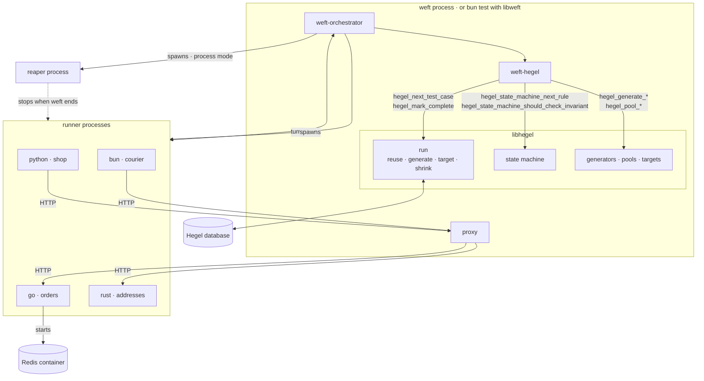

# weft

A distributed runner for [Hegel](https://hegel.dev) property tests. One KDL file declares the whole model: the entities and records, the state of each object, the pools, each action with its inputs, its pool effects and the state it writes, the invariants, and the function of the app that implements each action. The parser checks the model before any run, Hegel drives the actions as a state machine, and a runner only calls the app functions that the file names.

## Install

```sh
bun add -d git+ssh://git@github.com/ahmedtwine/weft.git#v0.7.0
```

## Run the examples

```sh
mise trust && mise install
mise //examples:test      # build weft and the four runners, then run each test
mise //examples:report    # run each test and serve the dashboard at http://127.0.0.1:7357
```

| Path                            | Holds                                                                  |
| ------------------------------- | ---------------------------------------------------------------------- |
| `examples/weft.kdl`             | The config: the tests, the styles, the `run` line and the runner lines |
| `examples/tests/`               | Each test, `*.weft.kdl`: the whole model of the test                   |
| `examples/services/<lang>/`     | The apps: plain code, independent of weft                              |
| `examples/runners/<lang>/`      | The runner entry of a language and its test entry                      |

## Config

`examples/weft.kdl`:

```kdl
include "tests/*.weft.kdl"
style "person" icon="user"
style "api" icon="server"
adapter "bun"
run cases=5 steps=50 check="sampled"
runner "rust" command="runners/rust/target/release/runner"
runner "go" command="runners/go/bin/runner"
runner "python" command="uv run --quiet --project runners/python python -m weft"
```

| Line                                  | Sets                                             |
| ------------------------------------- | ------------------------------------------------ |
| `include "<glob>"`                    | The test files                                   |
| `style "<kind>" icon="<lucide icon>"` | A kind of object                                 |
| `adapter "bun"`                       | The bun runner, which runs in `bun test`         |
| `runner "<lang>" command="<command>"` | The command that starts the runner of a language |
| `run cases= steps= check=`            | The values of each run; each value is required   |

| Key     | Value                                                                                                                                                          |
| ------- | -------------------------------------------------------------------------------------------------------------------------------------------------------------- |
| `cases` | The count of test cases for each test                                                                                                                          |
| `steps` | The largest count of steps in a test case                                                                                                                      |
| `check` | `"sampled"` checks an invariant after a step with the probability 1/`steps`, and `"always"` checks it after each step. Both check the first and the last state |

A test changes a value with its own `run` line, and an invariant changes `check` with its `check` key:

```kdl
run cases=200
setup {
  api "bank" {
    invariant check="always" {
      igte "bank.balance" 0
    }
  }
}
```

## Test

`examples/tests/bank.go.weft.kdl`:

```kdl
setup {
  person "owner"
  api "bank" {
    state {
      balance "int"
    }
    action "deposit" {
      input "amount" "1..100"
      writes "bank.balance"
    }
    action "withdraw" {
      input "amount" "1..100"
      writes "bank.balance"
    }
    invariant {
      igte "bank.balance" 0
    }
  }
}
impl "go" {
  module "bank" "../services/go/bank/bank.go" {
    reset "bank.Reset"
    state "bank.State"
    action "deposit" "bank.Deposit"
    action "withdraw" "bank.Withdraw"
  }
}
```

`examples/services/go/bank/bank.go` is the app, plain Go code:

```go
func Reset() { bank = Bank{} }

func State() Bank { return bank }

func Deposit(given Amount) { bank.Balance += given.Amount }

func Withdraw(given Amount) {
	if given.Amount <= bank.Balance {
		bank.Balance -= given.Amount
	}
}
```

With the `if` gone from `Withdraw`, the test fails, and Hegel shrinks the case to one step:

```text
✕ tests/bank.go.weft.kdl · bank.balance = -1 < 0
  0 · start · - · bank: balance = 0 · -
  1 · withdraw to=bank · amount=1 · bank: balance = -1 · bank.balance = -1 < 0
```

The same bank runs in each language: `services/rust/bank.rs`, `services/python/bank.py` and `services/bun/bank.ts`.

### Lines of a test

| Line                                            | Declares                                                                                                     |
| ----------------------------------------------- | ------------------------------------------------------------------------------------------------------------ |
| `<kind> "<object>" [<key>=<start>…]`            | An object; the first person calls each action in the diagram; each key sets the start value of a state key  |
| `entity "<name>" [ids=<n>] { <field> "<type>" }` | A type with an id; `ids=<n>` lets Hegel draw the ids `<name>1` to `<name><n>`                                |
| `record "<name>" { <field> "<type>" }`          | A type of plain records                                                                                      |
| `state { <key> "<type>" }`                      | The state of the object; the runner gives each key, and an invariant reads only these keys                   |
| `pool "<name>" of="<type>"`                     | A Hegel pool                                                                                                  |
| `target "<object>.<key>"`                       | A Hegel target: the integer, or the count of items, of the key after each step                               |
| `action "<verb>" { … }`                         | A rule of the state machine                                                                                  |
| `invariant { <condition> }`                     | A Quint builtin over the declared state                                                                      |
| `draw { <field> <value>… }`                     | The values that Hegel draws for each input field of that name                                                |
| `impl "<lang>" { module "<object>" "<path>" { … } }` | The runner of a language, the file of each module, and the function of each part                        |

### Types

| Type                                       | Value                                                     |
| ------------------------------------------ | --------------------------------------------------------- |
| `"int"`, `"<low>..<high>"`                 | An integer; a range bounds it                             |
| `"string"`, `"bool"`                       | A string, a boolean                                       |
| `"<entity>"`                               | The id of an entity, a string                             |
| `"<record>"`                               | A record of an entity, a `record`, or an inline `input` or `returns` |
| `"set"`, `"list"` with `of="<type>"`        | A list of values of the type                              |
| `"map"` with `of="<entity>"`               | A record of the entity for each id                        |
| `"optional"` with `of="<type>"`            | A value of the type, or `null`                            |

### Lines of an action

| Line                                                | Does                                                                                     |
| --------------------------------------------------- | ---------------------------------------------------------------------------------------- |
| `input "<name>" "<type>"`                           | Hegel draws the input from the type                                                      |
| `input "<name>" <field>="<type>"…`                  | Hegel draws a record named `<name>` with these fields                                   |
| `input "<name>" from="<pool>"`                      | Hegel draws a value of the pool and keeps it there                                       |
| `input "<name>" from="<pool>" take="consume"`       | Hegel draws a value of the pool and takes it out                                         |
| `input "<name>" from="<pool>" take="maybe"`         | Hegel draws a value of the pool or `null`                                                |
| `where { <condition> }`                             | A condition over the inputs; a step with a false condition is refused                    |
| `returns "<name>" "<type>"`, `returns "<name>" <field>="<type>"…` | The type of the result of the function                                 |
| `adds "<pool>" "<name>"`                            | After the step, adds the input or the result of that name to the pool                    |
| `writes "<object>.<key>[.<field>…]"`                | The state that the action changes                                                        |

A step with an empty pool is refused, and Hegel rejects the rule for that step. The function of the action gets one record with each input, and gives the result.

### What the parser checks

The parse accepts a test, before any runner starts, only when:

- each term names a declared object, state key, field or bound name;
- the two sides of each comparison have one type, and `in` looks for a value in a set of its type;
- each pool that an action draws from gets values from a reachable action; the reachable actions start from the actions that draw from pools only with `take="maybe"`;
- an action writes each state key that an invariant reads;
- each action has one function in the module of its object, and each `action` line of a module names a declared action;
- the module of each object with `state` names its `state` function;
- each drawn input has a bounded type: an `int` range, a `string`, a `bool`, an entity with `ids`, or a record or an optional of them.

```text
api curry: `curry.grants` is no declared state of `curry`; the `state` of `curry` has `accounts`, `conversations`
action `start_conversation` draws from the pool `seats`, and no reachable action adds to `seats`
the invariant at line 33 reads `curry.conversations`, and no action writes it; the action that changes it has `writes "curry.conversations"`
```

### Terms of an invariant

| Term                                  | Reads                                                         |
| ------------------------------------- | ------------------------------------------------------------- |
| `"<object>.<key>"`                    | A declared state key                                          |
| `(start)"<object>.<key>"`             | The key in the first state of the case                        |
| `"<name>.<field>…"`                   | A field of a name that `forall`, `exists` or an input binds   |
| `"<map>[<id>].<field>…"`              | A field of the record of an id in a map                       |
| `"<text>"`, an integer                | A value                                                       |

```kdl
invariant {
  forall "c" in="curry.conversations" {
    forall "u" in="c.readers" {
      in "u" "curry.accounts[c.account].members"
    }
  }
}
```

A failing invariant names its witness:

```text
in(curry.conversations[conversation2].readers[user1], curry.accounts[curry.conversations[conversation2].account].members) = in("user1", ["user2"]) = false
```

## The parcel example

`tests/parcel.weft.kdl` runs four apps, one in each runner:

| App         | Runner     | Does                                                                                   |
| ----------- | ---------- | -------------------------------------------------------------------------------------- |
| `orders`    | Go         | Keeps each order in Redis in a testcontainer                                           |
| `addresses` | Rust       | Keeps the address book                                                                 |
| `shop`      | Python     | Signs up customers, adds addresses, places orders, and changes the address of an order |
| `courier`   | TypeScript | Ships an order to its address                                                          |

Each app reaches another app at `WEFT_<MODULE>_URL`. weft forwards each request and records it as a hop. The test keeps the customers, the addresses and the orders in pools, and each value that an app makes enters a pool through `returns` and `adds`:

```kdl
action "place_order" {
  input "customer" from="customers"
  input "address" from="addresses"
  where {
    eq "address.owner" "customer"
  }
  returns "placed" id="order" customer="customer"
  adds "orders" "placed"
  writes "orders.orders"
}
```

The orders app checks the owner of the order, and the address book gives each address to any service, so a customer can choose the address of another customer:

```text
✕ tests/parcel.weft.kdl · courier.parcels[0].customer = "c-1" ≠ courier.parcels[0].recipient = "c-2"
```

The test fails by design.

## Runners

Each runner reads one variable, `WEFT`: JSON with the diagram, the transport, the path of libweft and the adapter. weft sends each runner the modules of its `impl` with the function of each part, and the runner only calls those functions. weft draws each input, keeps each pool and holds each type. A runner entry lists the functions it may call:

| Language   | Entry                                                                     | Function name in the test         |
| ---------- | ------------------------------------------------------------------------- | --------------------------------- |
| Go         | `weft.Run(bank.Reset, bank.State, bank.Deposit, …)`                       | `<package>.<Function>`            |
| Rust       | `weft_sdk::run(&weft_sdk::functions![bank::reset, bank::state, …])`       | `<module path>::<function>`       |
| Python     | `python -m weft`                                                          | The name of the function in the file |
| TypeScript | The bun harness                                                           | The name of the export of the file |

A function takes at most one input and gives a result: a value, an error, or both in Go and Rust.

A test runs in one of two modes:

| Mode    | Start                                                 | Hegel runs in                                          | Child runners stop                                                 |
| ------- | ----------------------------------------------------- | ------------------------------------------------------ | ------------------------------------------------------------------ |
| Process | `weft`, or a test entry with `WEFT_BIN=<weft>`        | The weft process                                       | By the reaper process when weft ends                               |
| Thread  | `bun test` of a file that calls `weft` of `weft/test` | A Rust thread of the bun test process, through libweft | When the run ends; on Linux also by SIGKILL at the end of bun test |

Each SDK has a test entry that joins the run as its own runner. The Go and Python entries use the process mode:

| Language   | Entry                                    | Command                                                                    |
| ---------- | ---------------------------------------- | -------------------------------------------------------------------------- |
| TypeScript | `examples/tests/parcel.test.ts`          | `bun test tests/parcel.test.ts` in `examples`                              |
| Go         | `examples/runners/go/parcel_test.go`     | `WEFT_BIN=<weft> go test ./runners/go` in `examples`                       |
| Python     | `examples/runners/python/test_parcel.py` | `WEFT_BIN=<weft> uv run --with pytest pytest` in `examples/runners/python` |



## Dashboard

`weft --ui [<file>…]` serves the dashboard at http://127.0.0.1:7357 and runs each test again when a file changes. A second `weft --ui` takes the port over from the first one, and the reaper of the first one stops its runners. Each test draws from its file before any run:

| In the test               | In the diagram                                                                                                                                                                                                                                              |
| ------------------------- | ----------------------------------------------------------------------------------------------------------------------------------------------------------------------------------------------------------------------------------------------------------- |
| `api "<object>"`          | A section                                                                                                                                                                                                                                                   |
| `impl "<lang>"`           | The label `<object> · <lang>` of the section                                                                                                                                                                                                                |
| Each `action`             | A node from the state of its section                                                                                                                                                                                                                        |
| Each `pool`               | A node with an `adds` link from each action that fills it, and a `reuse`, `consume` or `maybe` link to each action that draws from it                                                                                                                       |
| `writes` of another object | A `writes` link from the action to the state of that object                                                                                                                                                                                                |
| `invariant { … }`         | Its keys and each comparison, such as `customer = recipient`, in one color in the state box of the object; a link with the sign between two state boxes it compares; red with the sign of the failing values, such as `customer ≠ recipient`, when it fails |
| The first `person`        | The caller in the sequence diagram below                                                                                                                                                                                                                    |

The sequence diagram shows the lines of each state box in a note over its object, in the same colors. A run adds the test cases and the trace. Each step highlights its action, writes the state values into the section, and turns a broken invariant red. A hover on an action lists its steps.

## Crates

| Crate               | Does                                                                                                                                                                                     |
| ------------------- | ---------------------------------------------------------------------------------------------------------------------------------------------------------------------------------------- |
| `weft-parse`        | Reads `weft.kdl` and each test into the typed model, checks each term, pool and function of it, and evaluates invariants                                                                 |
| `weft-hegel`        | Drives Hegel through its C ABI: cases, the state machine, generators, pools and shrinking                                                                                                |
| `weft-orchestrator` | Starts the runners and the reaper, draws each input from the model, runs the pools, `where`, `adds` and `target` of each step, checks the state and the invariants, forwards the HTTP calls, and writes the report |
| `weft-wire`         | The framing of each message between weft and a runner                                                                                                                                    |
| `weft-draw`         | Draws a test as a sequence diagram, and each step as a state diagram and a sequence diagram                                                                                              |
| `weft-c`            | libweft, the C ABI that each SDK loads, and the thread mode of `weft/test`                                                                                                               |
| `weft-dashboard`    | Turns the spans of each run into Perspective tables and serves the dashboard                                                                                                             |
| `weft-cli`          | The `weft` command and the spans of each run                                                                                                                                             |
| `weft-samples`      | Draws candidate invariants from examples with a model; see [its README](crates/weft-samples/README.md)                                                                                   |
| `weft-invariants`   | Experimental: keeps the candidates that each state of a test makes true; see [its README](crates/weft-invariants/README.md)                                                              |

## License

MIT. `mise run notices` writes `THIRD-PARTY-NOTICES.md`, the license of each part weft ships: Hegel and each crate it links, the Lucide icons, Perspective and pele.
