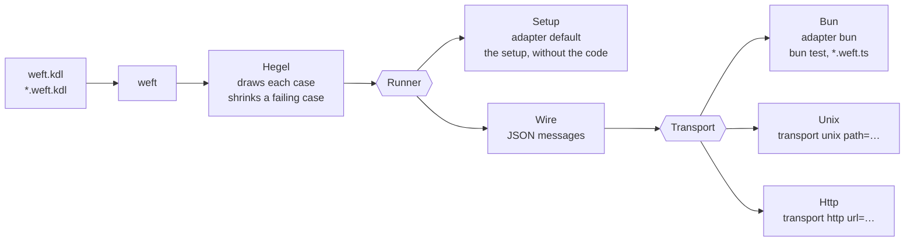

# weft

A distributed runner for property tests, built on [Hegel](https://hegel.dev) and [KDL](https://kdl.dev) files.

## Start

`weft.kdl`

```kdl
include "**/*.weft.kdl"
theme light
style person icon=user
style browser icon=app-window
adapter bun cases=100
```

`page.weft.kdl`

```kdl
setup {
  person user
  browser page count=0 {
    state count=0 {
      on send count=1
    }
    state count=1 {
      on reload count=1
    }
  }
}
action {
  send from=user to=page
  reload from=user to=page page.count=0
}
check {
  invariant {
    forall browser page {
      implies {
        in step reload
        eq (next)browser.count browser.count
      }
    }
  }
}
```

`page.weft.ts`

```ts
import { z } from "zod";

let count = 0;

export const state = z.strictObject({
  page: z.strictObject({ count: z.number().int().meta({ weft: "page.count" }) }),
});
export const read = () => ({ page: { count } });
export const reset = () => {
  count = 0;
};
export const send = {
  input: z.strictObject({}).meta({ weft: "send" }),
  run: () => {
    count += 1;
  },
};
export const reload = {
  input: z.strictObject({}).meta({ weft: "reload" }),
  run: () => {},
};
```

```
$ weft
✓ page.weft.kdl · Always, for each browser in page, if step is reload, then browser.count is unchanged
  adapter bun · 100 cases · 100 runs · holds
```

`weft --ui` opens the diagrams.

## Architecture



MIT. merman is MIT OR Apache-2.0. Icons are Lucide, ISC, in `crates/weft-draw/src/vendor`.
