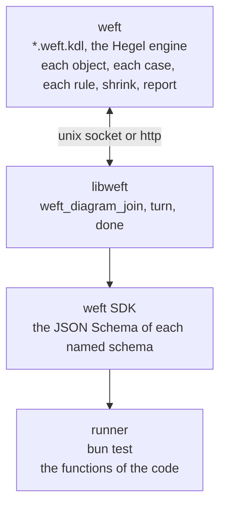

# weft

A distributed runner for property tests, built on [Hegel](https://hegel.dev) and [KDL](https://kdl.dev) files.



weft owns each case and draws each object. A runner sends the JSON Schema of each schema that the `impl` block names. weft draws each input from that schema with the Hegel engine and sends it with the turn. The runner calls the named function with the input and gives the state. A runner has no generator and makes no object.

## Start

Add `weft` from GitHub at a release tag, for example `bun add github:ahmedtwine/weft#v0.3.0`. The `weft` command gets the build of its version for the platform from the GitHub release on its first run, and runs it. Each tag `v<version>` of `package.json` and `Cargo.toml` makes a release with builds for `linux-x64` and `darwin-arm64`. The release is published only after the tests and clippy pass and the `weft` command and `libweft` of the release run on each platform. Otherwise the release and the tag are deleted.

`weft.kdl`

```kdl
include "**/*.weft.kdl"
theme "light"
style "person" icon="user"
style "browser" icon="app-window"
adapter "bun" cases=100
```

`src/page.ts`

```ts
import { z } from "zod";

let count = 0;
let text = "";

export const pageSchema = z.strictObject({
  count: z.number().int().meta({ weft: { read: "page.count" } }),
  text: z.string().meta({ weft: { read: "page.text" } }),
});
export const sendSchema = z
  .strictObject({ text: z.string() })
  .meta({ weft: { verb: "send" } });
export const reloadSchema = z.strictObject({}).meta({ weft: { verb: "reload" } });
export const page = () => ({ count, text });
export const clear = () => {
  count = 0;
  text = "";
};
export const send = (input: z.output<typeof sendSchema>) => {
  count += 1;
  text = input.text;
};
export const reload = () => {};
```

`invariants/page.weft.kdl`

```kdl
setup {
  person "user"
  browser "page" count=0 text="" {
    draw {
      text "hello" "good day"
    }
    on "send" count=(next)"page.count" text=(input)"text"
    on "reload"
    invariant "counted" {
      igte "page.count" (start)"page.count"
    }
  }
}
action {
  send from="user" to="page"
  reload from="user" to="page"
}
impl "bun" {
  module "page" "../src/page.ts"
  start "page.clear"
  read "page.page" output="page.pageSchema"
  run "page.send" input="page.sendSchema"
  run "page.reload" input="page.reloadSchema"
}
```

```
$ weft
✓ invariants/page.weft.kdl
  adapter bun · 100 cases · 100 runs · 1834 steps · 3668 checks [0.40s]
  page · on "send" count=(next)"page.count" text=(input)"text"
  page · on "reload"
  page · invariant "counted" { igte(page.count, start(page.count)) }
  step · action · input · state · check
  0 · start · - · page: count = 0, text = "" · -
  1 · send to=page · text="hello" · page: count = 1, text = hello · -
  2 · send to=page · text="hello" · page: count = 2, text = hello · -
  …
  action · steps · checks
  send to=page · 1156 · 2312
  reload to=page · 678 · 1356
  code · files · lines
  start · 1 · 4
  send · 1 · 4
  reload · 1 · 2
  draw · cases
  text "good day" · 87.0%
  text "hello" · 79.0%

 1 pass
 0 fail
 3668 checks
Ran 1 file in 0.41s
```

`weft <file>…` runs only the named diagrams. `weft --ui` serves the diagrams at http://127.0.0.1:7357.

## Diagram

A diagram has three blocks. Each rule of the code has one place in them.

```kdl
setup {
  <kind> "<object>" <key>=<value>… {
    pool "<pool>"
    draw {
      <key> <value>…
    }
    on "<verb>" <key>=<term>…
    state <key>=<value>… {
      on "<verb>" <key>=<term>…
    }
    invariant "<name>" {
      <condition>
    }
  }
}
action {
  <verb> from="<object>" to="<object>"
}
impl "<adapter>" {
  module "<name>" "<place>"
  start "<module>.<function>" input="<module>.<schema>"
  read "<module>.<function>" output="<module>.<schema>"
  run "<module>.<function>" input="<module>.<schema>"
}
```

| Line | Use |
| --- | --- |
| `<kind> "<object>" <key>=<value>…` | One object. A kind is `person`, `element`, `browser`, `db`, `api` or `file`. Each `<key>=<value>` is the value of the key after the `start` lines. |
| `on "<verb>" <key>=<term>…` | One step. Each term is the value of its key after the step. A key with no term has its value from before the step. |
| `state <key>=<value>… { on … }` | The `on` lines of the states that have these values. They are the `on` lines of the verb in those states. |
| `invariant "<name>" { <condition> }` | One condition on one state. It is true after the `start` lines and after each step. |
| `<verb> from="<object>" to="<object>"` | One step of the path of `action`. |

A key is `<object>.<key>` of a `read` annotation, or the name of a pool of the object.

### On

A step is one `run` of the code. After the step, weft compares each key of the object with the `on` lines of the verb. Two or more `on` lines of one verb are the cases of the step, and the step agrees with one of them. A verb runs only in a state that has an `on` line of the verb. Each `on` line runs in one case or more of a run of weft.

The key of the `error=` schema is `""` after a step that throws no `Error`. After a step that throws, each other key has its value from before the step. An `on` line with a term for that key gives the message of the step.

| Term | Value |
| --- | --- |
| `"idle"`, `0` | This text or this integer. |
| `(input)"<path>"` | The value at this path of the input of the step. |
| `"<object>.<key>"` | The value before the step. |
| `(next)"<object>.<key>"` | The value after the step. |
| `(start)"<object>.<key>"` | The value after the `start` lines. |

```kdl
db "session" state="idle" error="" {
  on "boot" state="booting"
  on "flush" error="a flush needs a booting document"
  state state="booting" {
    on "flush" state="ready"
  }
}
```

### Invariant

A condition is a Quint builtin, `<op> <term>… { <op line>… }`: `and`, `or`, `not`, `implies`, `iff`, `eq`, `neq`, `in`, `ilt`, `ilte`, `igt`, `igte`, `iadd`, `isub`, `imul`, `idiv`, `imod`, `ipow` or `iuminus`. A term is `"<object>.<key>"`, `(start)"<object>.<key>"` or a value. Each invariant is one invariant of the Hegel state machine, and the report names the invariant.

```kdl
invariant "restored" {
  implies {
    eq "page.restores" 0
    eq "page.html" (start)"page.html"
  }
}
```

## File

A file of weft has the KDL that versions 1 and 2 share. A parser of version 1 and a parser of version 2 read it the same.

| Part | Form |
| --- | --- |
| The name of a line, a key | A word: `browser`, `page.count`, `aria-label` |
| A text | A string in `"`: `"page"`, `""`, `"a \"b\""`, with the escapes `\n` `\r` `\t` `\\` `\"` `\b` `\f` `\u{…}` |
| A number | An integer of 64 bits: `0`, `-1` |
| The source of a term | `(input)"<path>"`, `(next)"<object>.<key>"`, `(start)"<object>.<key>"` |
| The end of a line | The end of its text line |
| A line with many values | `\` at the end of a text line continues the line |

```kdl
tagName \
  "div" "span" "p" "a" "li" "i" "button" \
  "input" "textarea" "select" "option" "img" "video"
```

## Impl

`impl "<adapter>"` joins the diagram to the code of one runner. It is the only source of objects.

| Line | Use |
| --- | --- |
| `module "<name>" "<place>"` | Code of the app that the runner loads. A place that starts with `../` is a file of the app, from the directory of the diagram. Each module has one line or more that names it. |
| `start "<module>.<function>" input="<module>.<schema>"` | Starts each case. weft draws one input for each `start` line, and the runner calls the functions in the order of the lines. A `start` line with no `input` calls a function that takes none. `tag="<verb>"` selects the branch of a union that has that verb. |
| `read "<module>.<function>" output="<module>.<schema>"` | Gives the state after the `start` lines and after each step. Each value of the state is JSON. Each key that the diagram names has a `read` annotation. |
| `run "<module>.<function>" input="<module>.<schema>"` | One action. The `verb` annotation of the schema is the verb. A union gives one action for each branch that has a verb. |
| `output="<module>.<schema>"` | On a `run` line. `{ input, result }` of the call is state after that step, with the `read` annotations of that schema. |
| `error="<module>.<schema>"` | On a `start` or `run` line. The message of an `Error` that the function throws is state, with the `read` annotations of that schema. The key is `""` after a call that throws no `Error`. The report shows the file and line of a `TypeError` or another fault of the code. |
| `pool="<pool>"` | On a `start` or `run` line. The result of the call goes to the pool. |
| `run "<pool>" from="<pool>" verb="<verb>"` | One action that calls a value of the pool. `"<pool>.<method>"` calls a method of the value. `consume="<pool>"` in the place of `from` removes the value from the pool. |

Each `verb` and `tag` is the verb of an `on` line. Each `pool` is a pool of an object of `setup`.

weft draws an input again, up to 4 times, until the schema parses it. Each line has one input or more that its schema parses.

weft draws each part of a schema that has a JSON Schema form.

## Annotation

An annotation is the `weft` key of the metadata of a part of a schema: `.meta({ weft: { verb: "send" } })`. `weft/annotation` gives its type, and `weft/annotation.schema.json` its JSON Schema.

| Key | Use |
| --- | --- |
| `verb` | The branch of an input that is one action of this verb. |
| `read` | The value of `<object>.<key>` in the state. |
| `pool` | Each drawn value of this part goes to this Hegel pool. |
| `from` | This part is a value of this Hegel pool. |
| `consume` | A `from` draw removes the value from the pool. |
| `maxLeaves` | The most leaves of one value of a schema that names itself. |
| `maxDepth` | The most levels of one value of a schema that names itself. |
| `grammar` | A Lark grammar of the texts of this part. |
| `start` | The start rule of the grammar. |

## Draw

The `draw` block of an object of `setup` gives the values of the fields of each input. A `<key> <value>…` line gives the values of one field in each input that has the field. A value applies only to a field of its type. A line with `{ }` has the lines of the keys of its part. The lines of a record with free keys are its keys, and a key has values or none. Each line applies to one field or more.

```kdl
draw {
  id 1 2 3
  attributes {
    class "is-empty" "a-icon-alt"
    title
  }
}
```

## Pool

A `pool "<name>"` line in an object of `setup` makes one Hegel pool. The key `<name>` of the object is the count of the values of the pool. A `pool` annotation or a `pool=` line adds values, and a `from` annotation or a `from=` line draws one of them.

## Action

weft runs the path of the `action` block in a quarter of the cases, with a drawn input for each step. In the other cases the Hegel state machine selects each verb. Hegel shrinks a case of the two forms to its least steps and values.

## Config

| Line | Use |
| --- | --- |
| `adapter "bun" cases=<count>` | weft starts `bun test` on the `impl "bun"` block of each diagram. |
| `adapter "default" cases=<count>` | weft waits for the runners of the `transport`. |
| `transport "unix" path="<socket>"` | Runners join on a unix socket. |
| `transport "http" url="<url>"` | Runners join over http. |

A runner on another machine runs `bun test` on `weft/harness` with `WEFT_LIB` set to libweft, `WEFT_TRANSPORT` to `unix:<socket>` or to the url and `WEFT_DIAGRAM` to the path of the diagram.

MIT. merman is MIT OR Apache-2.0. Icons are Lucide, ISC, in `crates/weft-draw/src/vendor`.
