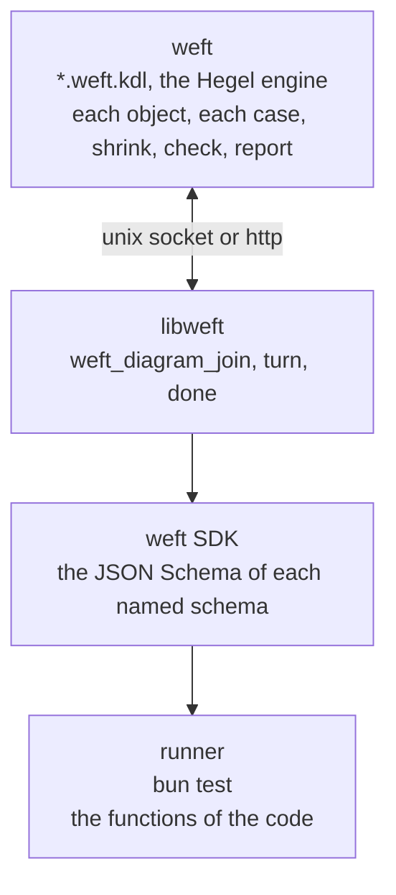

# weft

A distributed runner for property tests, built on [Hegel](https://hegel.dev) and [KDL](https://kdl.dev) files.



weft owns each case and draws each object. A runner sends the JSON Schema of each schema that the `impl` block names. weft draws each input from that schema with the Hegel engine and sends it with the turn. The runner calls the named function with the input and gives the state. A runner has no generator and makes no object.

## Start

Add `weft` from GitHub at a release tag, for example `bun add github:ahmedtwine/weft#v0.1.2`. The `weft` command gets the build of its version for the platform from the GitHub release on its first run, and runs it. Each tag `v<version>` of `package.json` and `Cargo.toml` makes a release with builds for `linux-x64` and `darwin-arm64`. The release is published only after the tests and clippy pass and the `weft` command and `libweft` of the release run on each platform. Otherwise the release and the tag are deleted.

`weft.kdl`

```kdl
include "**/*.weft.kdl"
theme light
style person icon=user
style browser icon=app-window
adapter bun cases=100
```

`src/page.ts`

```ts
import { z } from "zod";

let count = 0;

export const pageSchema = z.strictObject({
  count: z.number().int().meta({ weft: "page.count" }),
});
export const clearSchema = z.strictObject({});
export const sendSchema = z
  .strictObject({ text: z.string() })
  .meta({ weft: "send" });
export const reloadSchema = z.strictObject({}).meta({ weft: "reload" });
export const page = () => ({ count });
export const clear = () => {
  count = 0;
};
export const send = () => {
  count += 1;
};
export const reload = () => {};
```

`invariants/page.weft.kdl`

```kdl
setup {
  person user
  browser page count=0 {
    state count=0 {
      on send count=1
    }
    state count=1 {
      on reload count=1
    }
  }
}
action {
  send from=user to=page
  reload from=user to=page page.count=0
}
check {
  invariant {
    forall browser page {
      implies {
        in step reload
        eq (next)browser.count browser.count
      }
    }
  }
}
impl bun {
  module page "../src/page.ts"
  start page.clear input=page.clearSchema
  read page.page output=page.pageSchema
  run page.send input=page.sendSchema
  run page.reload input=page.reloadSchema
}
```

```
$ weft
✓ invariants/page.weft.kdl · Always, for each browser in page, if step is reload, then browser.count stays unchanged
  adapter bun · 100 cases · 100 runs · 1191 steps · 1091 checks [0.94s]
  step · action · input · state · check
  0 · start · - · page: count = 0 · -
  1 · send to=page · text="¯¯¯¯¯¯¯¯¯¯¯¯¯¯¯¯¯¯¯¯¯¯¯" · page: count = 1 · -
  2 · reload to=page · - · page: count = 1 · -
  …
  action · steps · checks
  send to=page · 100 · 0
  reload to=page · 1091 · 1091
  code · files · lines
  start · 1 · 3
  send · 1 · 3
  reload · 1 · 2

 1 pass
 0 fail
 1091 checks
Ran 1 file in 0.98s
```

`weft --ui` serves the diagrams at http://127.0.0.1:7357.

## Impl

`impl <adapter>` joins the diagram to the code of one runner. It is the only source of objects.

| Line | Use |
| --- | --- |
| `module <name> "<place>"` | Code of the app that the runner loads. A place that starts with `../` is a file from the directory of the diagram. weft refuses a file in the directory of the diagram. |
| `start <module>.<function> input=<module>.<schema>` | Starts each case. weft draws one input for each `start` line, and the runner calls the functions in the order of the lines. A `start` line with no `input` calls a function that takes none. `tag=<tag>` selects one branch of a union. |
| `read <module>.<function> output=<module>.<schema>` | Gives the state after the `start` lines and after each step. Each field that the check reads has the tag `<object>.<key>`. |
| `run <module>.<function> input=<module>.<schema>` | One action. The tag of the schema is the verb. A union gives one action for each branch that has a tag. |
| `error=<module>.<schema>` | On a `start` or `run` line. The message of an `Error` that the function throws is state, with the tags of that schema. Without it, a throw fails the step. A `TypeError` or another fault of the code always fails the step, and the report shows its file and line. |

A tag is the `weft` key of the metadata of a schema: `.meta({ weft: "send" })`.

weft draws an input again, up to 4 times, when the schema does not parse it. After that, the input is no step. weft fails the run when each input of one line fails its schema.

A part of a schema with no JSON Schema form has no value, and weft draws no branch that needs it.

## Draw

A `draw <key>.<key>… <value>…` line in an object of `setup` gives the values of one field in each input that has the field. A value applies only to a field of its type. weft fails the run when a `draw` line applies to no field.

```kdl
setup {
  browser page count=0 {
    draw text hello "good day"
    state count=0 { on send count=1 }
    …
  }
}
```

## Action

weft runs the path of the `action` block in a quarter of the cases, with a drawn input for each step. The other cases run the verbs in a drawn order. A failing case shrinks in the two forms.

## Config

| Line | Use |
| --- | --- |
| `adapter bun cases=<count>` | weft starts `bun test` on the `impl bun` block of each diagram. |
| `adapter default cases=<count>` | weft runs the setup without the code, or waits for runners when the config has a `transport`. |
| `transport unix path=<socket>` | Runners join on a unix socket. |
| `transport http url=<url>` | Runners join over http. |

A runner on another machine runs `bun test` on `weft/harness` with `WEFT_LIB` set to libweft, `WEFT_TRANSPORT` to `unix:<socket>` or to the url and `WEFT_DIAGRAM` to the path of the diagram.

MIT. merman is MIT OR Apache-2.0. Icons are Lucide, ISC, in `crates/weft-draw/src/vendor`.
