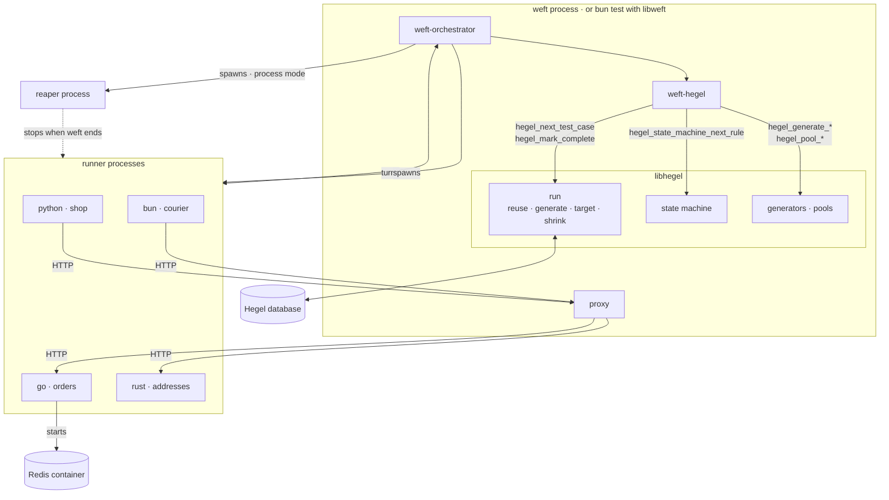

# weft

A distributed runner for [Hegel](https://hegel.dev) property tests

## Install

```sh
bun add -d git+ssh://git@github.com/ahmedtwine/weft.git#v0.6.1
```


## Run 

```sh
mise trust && mise install
mise //examples:test      # build weft and the four runners, then run each test
mise //examples:report    # serve the dashboard at http://127.0.0.1:7357
```

`examples/tests/*.weft.kdl` has the example tests. `examples/runners/<lang>/` shows the runners in the supported languages. Register the runners in the `impl` block

### Test

`examples/tests/bank.bun.weft.kdl`:

```kdl
setup {
  person "owner"
  api "bank" {
    invariant "the balance never goes below zero" {
      igte "bank.balance" 0
    }
  }
}
impl "bun" {
  module "bank" "../runners/bun/bank/bank.ts"
}
```

### Runner

`examples/runners/bun/bank/bank.ts`:

```ts
import { state } from "weft";
import { z } from "zod";

const bank = { balance: 0 };
state("bank", () => bank);

export const depositSchema = z.object({ amount: z.int().min(1).max(100) });
export const withdrawSchema = depositSchema;

export const reset = () => {
  bank.balance = 0;
};
export const deposit = ({ amount }: z.infer<typeof depositSchema>) => {
  bank.balance += amount;
};
export const withdraw = ({ amount }: z.infer<typeof withdrawSchema>) => {
  if (amount <= bank.balance) bank.balance -= amount;
};
```

Hegel draws `deposit` and `withdraw` in any order with amounts from 1 to 100, and checks the balance after each step with shrinking:

```text
✕ tests/bank.bun.weft.kdl · "the balance never goes below zero" · bank.balance = -1 < 0
```


## Multiple Runner Example (For multi-service invariant testing)

`tests/parcel.weft.kdl` runs four apps, one in each runner: `orders` in Go keeps each order in Redis in a testcontainer, `shop` in Python lets a customer choose the address of an order, and `courier` in TypeScript ships an order to its address. 

Each app reaches the others at `WEFT_<MODULE>_URL`. Each runner reads one variable, `WEFT`: JSON with the diagram, the transport, the path of libweft and the adapter.

| Mode | Start | Hegel runs in | Child runners stop |
| --- | --- | --- | --- |
| Process | `weft`, or `WEFT_BIN=<weft> bun test` | The weft process | By the reaper process when weft ends |
| Thread | `bun test` of a file that calls `weft` of `weft/test` | A Rust thread of the bun test process, through libweft | When the run ends; on Linux also by SIGKILL when the bun test process ends |

`tests/parcel.test.ts` runs the same test in each mode: `bun test tests/parcel.test.ts` in the thread mode, and `WEFT_BIN=../target/release/weft bun test tests/parcel.test.ts` in the process mode.



The orders app checks that the customer owns the order, and the address book trusts the courier, so a customer can choose the address of another customer:

```kdl
api "courier" {
  invariant "a parcel goes only to the address of its own customer" {
    forall "p" in="courier.parcels" {
      eq "p.customer" "p.recipient"
    }
  }
}
```

```text
✕ tests/parcel.weft.kdl · "a parcel goes only to the address of its own customer" · courier.parcels[0].customer = "c-1" ≠ courier.parcels[0].recipient = "c-2"
```

## Dashboard

`weft --ui` runs each test and serves a live dashboard at http://127.0.0.1:7357. Each run sends OpenTelemetry spans: one for each test case, step and HTTP request. The dashboard reads them into [Perspective](https://perspective-dev.github.io) tables as they arrive


## Crates

| Crate               | Does                                                                                                                                                                        |
| ------------------- | --------------------------------------------------------------------------------------------------------------------------------------------------------------------------- |
| `weft-parse`        | Reads `weft.kdl` and each test into objects, invariants and modules, and evaluates invariants                                                                               |
| `weft-hegel`        | Drives Hegel through its C ABI: cases, the state machine, generators and shrinking                                                                                          |
| `weft-orchestrator` | Starts the runners and the reaper, turns the schemas of each runner into generators, runs each case with Hegel, forwards the HTTP calls between apps, and writes the report |
| `weft-wire`         | The framing of each message between weft and a runner                                                                                                                       |
| `weft-draw`         | Draws a test as a sequence diagram, and each step as a sequence diagram or a flowchart                                                                                      |
| `weft-c`            | libweft, the C ABI that each SDK loads, and the thread mode of `weft/test`                                                                                                  |
| `weft-dashboard`    | Turns the spans of each run into Perspective tables and serves the dashboard                                                                                                |
| `weft-cli`          | The `weft` command and the spans of each run                                                                                                                                |
| `weft-samples`      | Draws candidate invariants from examples with a model; see [its README](crates/weft-samples/README.md)                                                                      |
| `weft-invariants`   | Experimental: keeps the candidates that the states of a test do not make false; see [its README](crates/weft-invariants/README.md)                                          |

## License

MIT. `mise run notices` writes `THIRD-PARTY-NOTICES.md`, the license of each part weft ships: Hegel and each crate it links, the Lucide icons, Perspective and pele.
