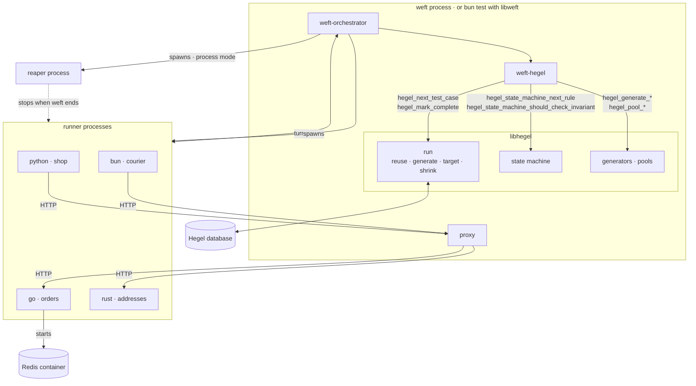

# weft

A distributed runner for [Hegel](https://hegel.dev) property tests. A test names its objects, the invariants over their state, and the module of each object. Hegel runs the functions of the modules in each order with inputs from their native types, checks the invariants, and shrinks a failing case to the fewest steps.

## Install

```sh
bun add -d git+ssh://git@github.com/ahmedtwine/weft.git#v0.7.0
```

## Run the examples

```sh
mise trust && mise install
mise //examples:test      # build weft and the four runners, then run each test
mise //examples:report    # run each test and serve the dashboard at http://127.0.0.1:7357
```

| Path                              | Holds                                                                  |
| --------------------------------- | ---------------------------------------------------------------------- |
| `examples/weft.kdl`               | The config: the tests, the styles, the `run` line and the runner lines |
| `examples/tests/`                 | Each test, `*.weft.kdl`                                                |
| `examples/runners/<lang>/`        | The runner of a language and its test entry                            |
| `examples/runners/<lang>/<test>/` | The modules of a test in that language                                 |

## Config

`examples/weft.kdl`:

```kdl
include "tests/*.weft.kdl"
style "person" icon="user"
style "api" icon="server"
adapter "bun"
run cases=5 steps=50 check="sampled"
runner "rust" command="runners/rust/target/release/runner"
runner "go" command="runners/go/bin/runner"
runner "python" command="uv run --quiet --project runners/python python -m weft"
```

| Line                                  | Sets                                             |
| ------------------------------------- | ------------------------------------------------ |
| `include "<glob>"`                    | The test files                                   |
| `style "<kind>" icon="<lucide icon>"` | A kind of object                                 |
| `adapter "bun"`                       | The bun runner, which runs in `bun test`         |
| `runner "<lang>" command="<command>"` | The command that starts the runner of a language |
| `run cases= steps= check=`            | The values of each run; each value is required   |

| Key     | Value                                                                                                                                                         |
| ------- | ------------------------------------------------------------------------------------------------------------------------------------------------------------- |
| `cases` | The count of test cases for each test                                                                                                                         |
| `steps` | The largest count of steps in a test case                                                                                                                     |
| `check` | `"sampled"` checks an invariant after a step with the probability 1/`steps`, and `"always"` checks it after each step. Both check the first and the last state |

A test changes a value with its own `run` line, and an invariant changes `check` with its `check` key:

```kdl
run cases=200
setup {
  api "bank" {
    invariant "the balance never goes below zero" check="always" {
      igte "bank.balance" 0
    }
  }
}
```

## Test

`examples/tests/bank.bun.weft.kdl`:

```kdl
setup {
  person "owner"
  api "bank" {
    invariant "the balance never goes below zero" {
      igte "bank.balance" 0
    }
  }
}
impl "bun" {
  module "bank" "../runners/bun/bank/bank.ts"
}
```

| Line                                 | Gives                                                                      |
| ------------------------------------ | -------------------------------------------------------------------------- |
| `<kind> "<object>"`                  | An object; the first person calls each action in the diagram               |
| `invariant "<name>" { <condition> }` | A Quint builtin over the state: `eq`, `igte`, `implies`, `forall` and more |
| `impl "<lang>" { module … }`         | The runner of a language and the module of each of its objects            |

An `impl` block holds `module` lines only. The module gives the rest:

| Export of the module | Is                                                                                        |
| -------------------- | ----------------------------------------------------------------------------------------- |
| `reset`              | The function that sets the state before each case                                         |
| `url`                | The function that gives the url of an HTTP app                                            |
| each other function  | An action; its name is the verb, and Hegel draws its input from the type of its parameter |

The input of an action is a native type: a `JsonSchema` type in Rust, a struct with `minimum` and `maximum` tags in Go, a dataclass with `Literal` or `Annotated[int, range(…)]` in Python, and the zod schema `<function>Schema` in TypeScript. An action that also takes a `TestCase` draws more values during its step: `tc.draw(…)`, `tc.assume(…)`, and the pools `Pool(tc, "<name>").add(…)` and `.values_reusable()`.

`examples/runners/bun/bank/bank.ts`:

```ts
import { state } from "weft";
import { z } from "zod";

const bank = { balance: 0 };
state("bank", () => bank);

export const depositSchema = z.object({ amount: z.int().min(1).max(100) });
export const withdrawSchema = depositSchema;

export const reset = () => {
  bank.balance = 0;
};
export const deposit = ({ amount }: z.infer<typeof depositSchema>) => {
  bank.balance += amount;
};
export const withdraw = ({ amount }: z.infer<typeof withdrawSchema>) => {
  if (amount <= bank.balance) bank.balance -= amount;
};
```

Hegel draws `deposit` and `withdraw` in any order with amounts from 1 to 100. With the `if` gone from `withdraw`, the test fails, Hegel shrinks the case to one step, and the failure gives the operator and its place:

```text
✕ tests/bank.bun.weft.kdl · "the balance never goes below zero" · bank.balance = -1 < 0
  bun · … · igte at tests/bank.bun.weft.kdl:5:7
```

The same bank runs in each language: `runners/rust/bank/bank.rs`, `runners/go/bank/bank.go` and `runners/python/bank/bank.py`.

## State

A module gives its state to weft with one call, under `"<object>"` or `"<object>.<key>"`. The SDK sends the JSON Schema of the native type, and weft checks each key and field of each invariant against it before the first case.

| Language   | SDK          | Call                                                       |
| ---------- | ------------ | ---------------------------------------------------------- |
| TypeScript | `sdk/`       | `state("courier.parcels", () => parcels, z.array(Parcel))` |
| Rust       | `sdk/rust`   | `weft_sdk::state("bank", now)` with `JsonSchema`           |
| Go         | `sdk/go`     | `weft.State("bank", func() Bank { return bank })`          |
| Python     | `sdk/python` | `weft.state("bank", lambda: bank)` with a dataclass        |

## A shop of four apps

`tests/parcel.weft.kdl` runs four apps, one in each runner:

| App         | Runner     | Does                                                                                     |
| ----------- | ---------- | ---------------------------------------------------------------------------------------- |
| `orders`    | Go         | Keeps each order in Redis in a testcontainer                                             |
| `addresses` | Rust       | Keeps the address book                                                                   |
| `shop`      | Python     | Signs up customers, adds addresses, places orders, and changes the address of an order  |
| `courier`   | TypeScript | Ships an order to its address                                                            |

Each app reaches another app at `WEFT_<MODULE>_URL`. weft forwards each request and records it as a hop. The shop keeps the customers, the addresses and the orders in Hegel pools, so Hegel builds the data of each case.

The orders app checks the owner of the order, and the address book gives each address to any service, so a customer can choose the address of another customer:

```kdl
api "courier" {
  invariant "a parcel goes only to the address of its own customer" {
    forall "p" in="courier.parcels" {
      eq "p.customer" "p.recipient"
    }
  }
}
```

```text
✕ tests/parcel.weft.kdl · "a parcel goes only to the address of its own customer" · courier.parcels[0].customer = "c-1" ≠ courier.parcels[0].recipient = "c-2"
```

The test fails by design.

## Runners

Each runner reads one variable, `WEFT`: JSON with the diagram, the transport, the path of libweft and the adapter. A test runs in one of two modes:

| Mode    | Start                                                 | Hegel runs in                                          | Child runners stop                                                 |
| ------- | ----------------------------------------------------- | ------------------------------------------------------ | ------------------------------------------------------------------ |
| Process | `weft`, or a test entry with `WEFT_BIN=<weft>`        | The weft process                                       | By the reaper process when weft ends                               |
| Thread  | `bun test` of a file that calls `weft` of `weft/test` | A Rust thread of the bun test process, through libweft | When the run ends; on Linux also by SIGKILL at the end of bun test |

Each SDK has a test entry that joins the run as its own runner. The Go and Python entries use the process mode:

| Language   | Entry                                     | Command                                                                     |
| ---------- | ----------------------------------------- | --------------------------------------------------------------------------- |
| TypeScript | `examples/tests/parcel.test.ts`           | `bun test tests/parcel.test.ts` in `examples`                               |
| Go         | `examples/runners/go/parcel_test.go`      | `WEFT_BIN=<weft> go test .` in `examples/runners/go`                        |
| Python     | `examples/runners/python/test_parcel.py`  | `WEFT_BIN=<weft> uv run --with pytest pytest` in `examples/runners/python`  |



## Dashboard

`weft --ui [<file>…]` serves the dashboard at http://127.0.0.1:7357 and runs each test again when a file changes. A second `weft --ui` takes the port over from the first one, and the reaper of the first one stops its runners. Each test draws from its file before any run:

| In the test                   | In the diagram                                      |
| ----------------------------- | --------------------------------------------------- |
| `api "<object>"`              | A section                                           |
| `impl "<lang>"`               | The label `<object> · <lang>` of the section        |
| Each action of the module     | A node from the state of its section                |
| Each comparison of an invariant | The fields it compares, one link between them labelled `=`, `≠` or `≥`; a stacked box for a field of each item |
| The first `person`            | The caller in the sequence diagram below            |

A run adds the test cases and the trace. Each step highlights its action, writes the state values into the section, and turns a broken invariant red. A hover on an action lists its steps.

## Crates

| Crate               | Does                                                                                                                                                                                     |
| ------------------- | ---------------------------------------------------------------------------------------------------------------------------------------------------------------------------------------- |
| `weft-parse`        | Reads `weft.kdl` and each test into objects, invariants and modules, and evaluates invariants                                                                                            |
| `weft-hegel`        | Drives Hegel through its C ABI: cases, the state machine, generators, pools and shrinking                                                                                                |
| `weft-orchestrator` | Starts the runners and the reaper, turns the schemas of each runner into generators, runs the rounds of each case, checks the invariants, forwards the HTTP calls, and writes the report |
| `weft-wire`         | The framing of each message between weft and a runner                                                                                                                                   |
| `weft-draw`         | Draws a test as a sequence diagram, and each step as a sequence diagram or a flowchart                                                                                                   |
| `weft-c`            | libweft, the C ABI that each SDK loads, and the thread mode of `weft/test`                                                                                                               |
| `weft-dashboard`    | Turns the spans of each run into Perspective tables and serves the dashboard                                                                                                             |
| `weft-cli`          | The `weft` command and the spans of each run                                                                                                                                             |
| `weft-samples`      | Draws candidate invariants from examples with a model; see [its README](crates/weft-samples/README.md)                                                                                   |
| `weft-invariants`   | Experimental: keeps the candidates that each state of a test makes true; see [its README](crates/weft-invariants/README.md)                                                              |

## License

MIT. `mise run notices` writes `THIRD-PARTY-NOTICES.md`, the license of each part weft ships: Hegel and each crate it links, the Lucide icons, Perspective and pele.
