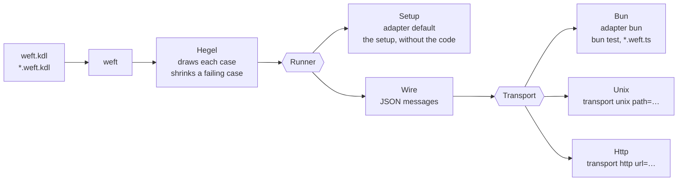

# weft

A distributed runner for property tests, built on [Hegel](https://hegel.dev) and [KDL](https://kdl.dev) files.

## Start

`weft.kdl`

```kdl
include "**/*.weft.kdl"
theme light
style person icon=user
style browser icon=app-window
adapter bun cases=100
```

`src/page.ts`

```ts
import { z } from "zod";

let count = 0;

export const pageSchema = z.strictObject({
  count: z.number().int().meta({ weft: "page.count" }),
});
export const sendSchema = z
  .strictObject({ text: z.string() })
  .meta({ weft: "send" });
export const reloadSchema = z.strictObject({}).meta({ weft: "reload" });
export const page = () => ({ count });
export const clear = () => {
  count = 0;
};
export const send = () => {
  count += 1;
};
export const reload = () => {};
```

`invariants/page.weft.kdl`

```kdl
setup {
  person user
  browser page count=0 {
    state count=0 {
      on send count=1
    }
    state count=1 {
      on reload count=1
    }
  }
}
action {
  send from=user to=page
  reload from=user to=page page.count=0
}
check {
  invariant {
    forall browser page {
      implies {
        in step reload
        eq (next)browser.count browser.count
      }
    }
  }
}
```

`invariants/page.weft.ts`

```ts
import { z } from "zod";
import {
  clear,
  page,
  pageSchema,
  reload,
  reloadSchema,
  send,
  sendSchema,
} from "../src/page";

export const state = z.strictObject({ page: pageSchema });
export const read = () => ({ page: page() });
export const reset = clear;
export const sent = { input: sendSchema, run: send };
export const reloaded = { input: reloadSchema, run: reload };
```

```
$ weft
✓ invariants/page.weft.kdl · Always, for each browser in page, if step is reload, then browser.count stays unchanged
  adapter bun · 100 cases · 100 runs · 1490 steps · 1391 checks [3.89s]
  step · action · input · state · check
  0 · start · - · page: count = 0 · -
  1 · send to=page · text="¬-\u0001¬\u0001--¬-¬" · page: count = 1 · -
  2 · reload to=page · - · page: count = 1 · -
  …
  action · steps · checks
  send to=page · 99 · 0
  reload to=page · 1391 · 1391
  code · files · lines
  reset · 2 · 4
  send · 2 · 4
  reload · 2 · 3

 1 pass
 0 fail
 1391 checks
Ran 1 file in 3.89s
```

`weft --ui` serves the diagrams at http://127.0.0.1:7357.

## Driver

The driver joins the diagram to the code. It has no schema and no function of its own.

| Export | Use |
| --- | --- |
| `state` | The schema of the state. Each field that the check reads has the tag `<object>.<key>`. |
| `read` | Gives the state after `reset` and after each step. |
| `reset` | Starts each case. |
| `{ input, run }` | One action. The tag of `input` is the verb. A union gives one action for each branch that has a tag. |
| `{ output, of, name }` | One mock. Hegel draws `output` at each `reset`, and `of[name]` gives that value. |

weft refuses a tag that a file in the directory of the diagram makes, and a `run` that such a file exports.

Hegel draws each input from the JSON Schema of `input`: `boolean`, `integer`, `number`, `string` with `minLength`, `maxLength`, `pattern` or `format`, `null`, `enum`, `const`, `anyOf`, `oneOf`, `allOf` of objects, `array` with `items`, `prefixItems` and `uniqueItems`, `object` with `properties` or `additionalProperties`, `$ref` to `$defs`, and a schema that holds itself.

An input that `input` does not parse is no step.

A throw of `run` fails the step. When `read` takes a parameter, it gets the error, and the driver gives it as state:

```ts
export const read = (error?: Error) => ({
  page: { ...page(), error: error?.message ?? "" },
});
```

## Architecture



MIT. merman is MIT OR Apache-2.0. Icons are Lucide, ISC, in `crates/weft-draw/src/vendor`.
