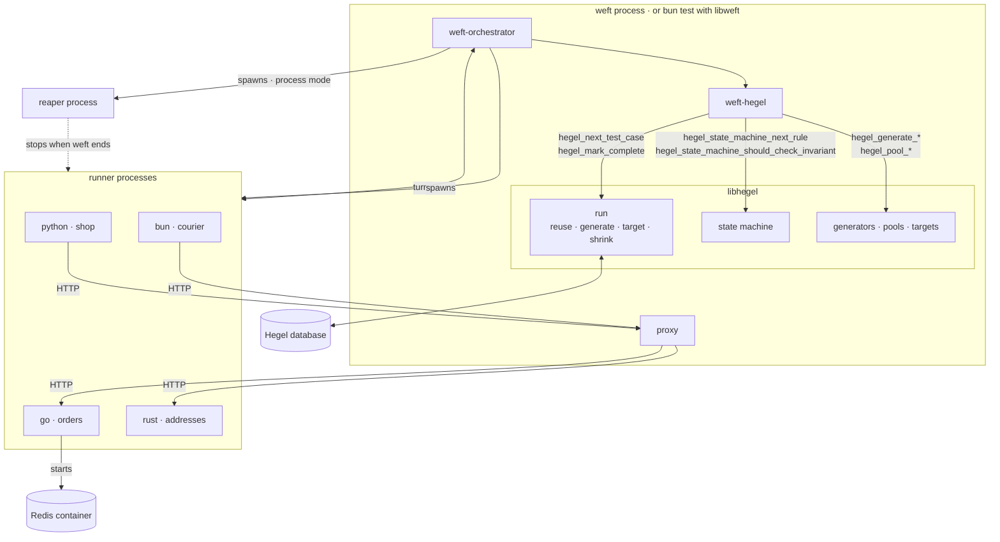

# weft

A DSL for modeling software state space and invariants for [Hegel](https://hegel.dev) property testing, with a distributed runner.

## Install

```sh
bun add -d git+https://github.com/ahmedtwine/weft.git#v0.7.0
```

## Example Tests

`examples/tests/bank.go.weft.kdl` defines a state machine test and binds it to the Go implementation:

```kdl
setup {
  person "owner"
  api "bank" {
    state {
      balance "int"
    }
    action "deposit" {
      input "amount" "1..100"
      writes "bank.balance"
    }
    action "withdraw" {
      input "amount" "1..100"
      writes "bank.balance"
    }
    invariant {
      igte "bank.balance" 0
    }
  }
}
impl "go" {
  module "bank" "../services/go/bank/bank.go" {
    reset "bank.Reset"
    state "bank.State"
    action "deposit" "bank.Deposit"
    action "withdraw" "bank.Withdraw"
  }
}
```

`examples/services/go/bank/bank.go` contains the application logic in plain Go:

```go
func Reset() { bank = Bank{} }

func State() Bank { return bank }

func Deposit(given Amount) { bank.Balance += given.Amount }

func Withdraw(given Amount) {
	if given.Amount <= bank.Balance {
		bank.Balance -= given.Amount
	}
}
```

```text
✕ tests/bank.go.weft.kdl · bank.balance = -1 < 0
  0 · start · - · bank: balance = 0 · -
  1 · withdraw to=bank · amount=1 · bank: balance = -1 · bank.balance = -1 < 0
```

## Single Test with Multiple Language Runners

`tests/parcel.weft.kdl` runs the 4 example runners together in a single test:

| App         | Runner     | Does                                                                                   |
| ----------- | ---------- | -------------------------------------------------------------------------------------- |
| `orders`    | Go         | Stores each order in Redis inside a testcontainer                                      |
| `addresses` | Rust       | Stores the address book                                                                |
| `shop`      | Python     | Signs up customers, adds addresses, places orders, and changes the address on an order |
| `courier`   | TypeScript | Ships an order to its destination address                                              |

Each application calls the others through `WEFT_<MODULE>_URL`. Weft forwards every request and records it as a hop:

```kdl
action "place_order" {
  input "customer" from="customers"
  input "address" from="addresses"
  where {
    eq "address.owner" "customer"
  }
  returns "placed" id="order" customer="customer"
  adds "orders" "placed"
  writes "orders.orders"
}
```



## Dashboard

`weft --ui [<file>…]` serves the test runner page at http://127.0.0.1:7357. `weft collect` serves the collector page at http://127.0.0.1:4318. Both pages use the same `weft-dashboard` server: `/schema` gives the tables and `/events` streams the rows into [Perspective](https://perspective.finos.org).

## Collector

`weft collect [<source>]` receives OTLP/HTTP traces and logs, in JSON or protobuf, at http://127.0.0.1:4318:

```sh
weft collect ../app
export OTEL_EXPORTER_OTLP_ENDPOINT=http://127.0.0.1:4318
```

The page shows the service map over two panes: the call graph of each trace and one live stream of spans and logs (`in`, `out`, `work`, `log`) with the linked code. Each client call joins the backend route that served it. Click a service, path or operation to narrow both panes.

With `<source>`, weft runs [`spool map`](https://github.com/ahmedtwine/spool) on that codebase and links each span to its code by `http.route`, `code.stacktrace` (with source maps) or `code.file.path` and `code.line.number`. Logs show `code.file.path` or `log.file` as their code. `spool` must be on `PATH`, and the port opens only after the map is read, so start the collector before the services that export to it.

Received exports are kept in `~/.cache/weft/collect.otlp` and replay on restart.

## License

MIT. Third-party licenses are in `THIRD-PARTY-NOTICES.md`.
